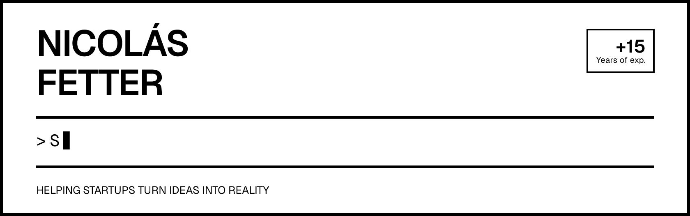
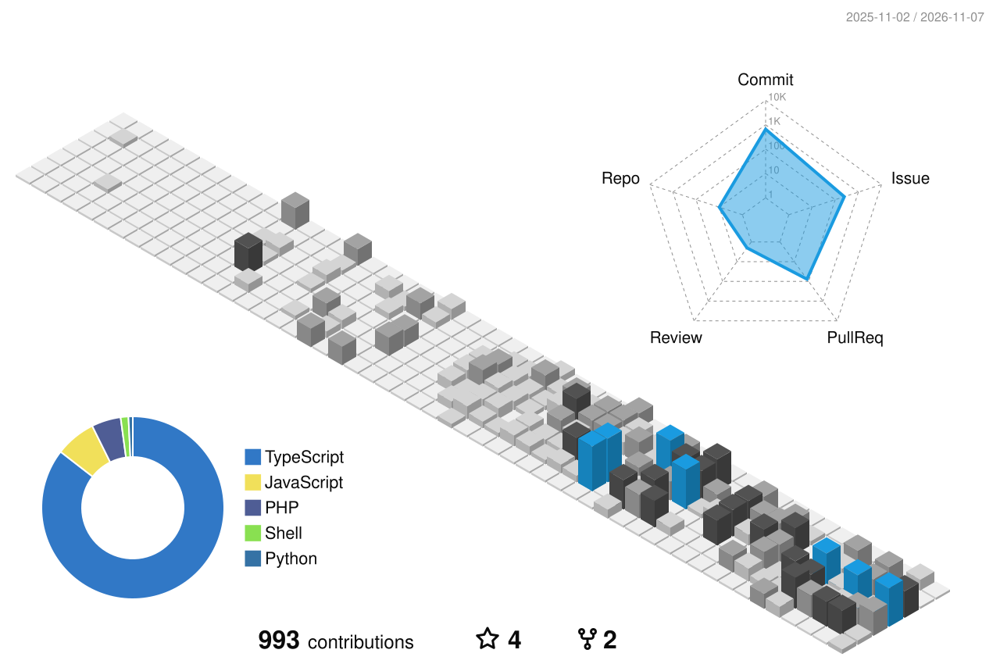

  <a href="https://x.com/nicofetter" target="_blank"><picture><source media="(prefers-color-scheme: dark)" srcset="assets/buttons/x-dark.svg"></picture></a>
  <a href="https://www.linkedin.com/in/nicofetter" target="_blank"><picture><source media="(prefers-color-scheme: dark)" srcset="assets/buttons/linkedin-dark.svg"></picture></a>
  <a href="https://nicofetter.com" target="_blank"><picture><source media="(prefers-color-scheme: dark)" srcset="assets/buttons/website-dark.svg"></picture></a>

I'm a software engineer from Argentina living in Spain, building for the web since 2010. Currently working for startups integrating AI into customer facing products.

I'm also the maker of [TinyInvoice.app](https://tinyinvoice.app) a simple online tool to create and send pdf invoices. And the founder of [TheHype.nz](https://thehype.nz) a digital agency for New Zealand small businesses.

### Activity

<picture>
  <source media="(prefers-color-scheme: dark)" srcset="https://raw.githubusercontent.com/nicomfe/nicomfe/output/stats-dark.svg">
  
</picture>

<picture>
  <source media="(prefers-color-scheme: dark)" srcset="https://raw.githubusercontent.com/nicomfe/nicomfe/output/contrib-3d-dark.svg">
  
</picture>

Activity graphics refresh daily with GitHub Actions.

